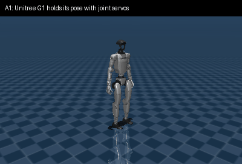
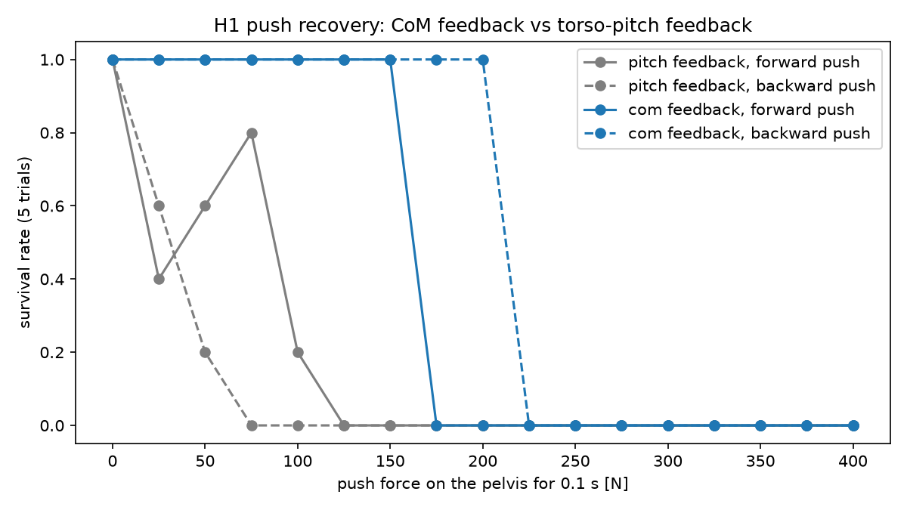
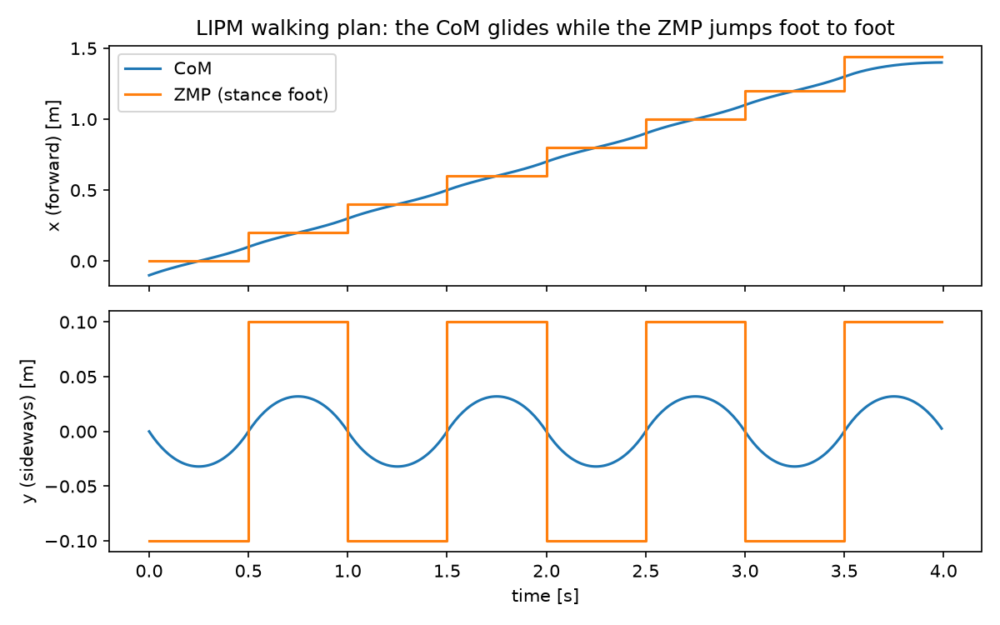
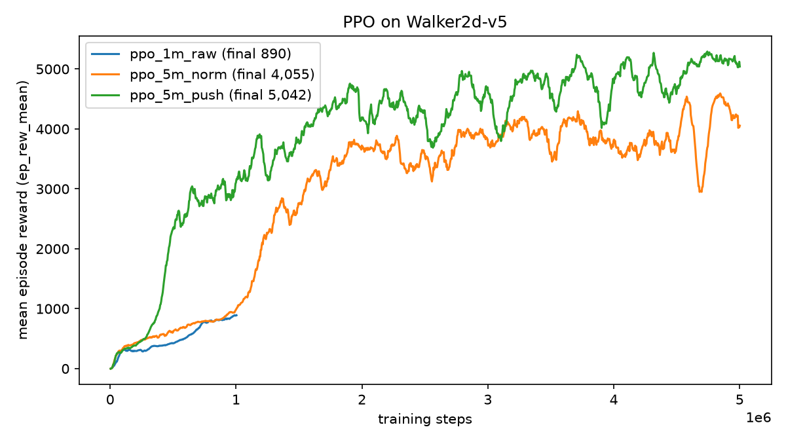
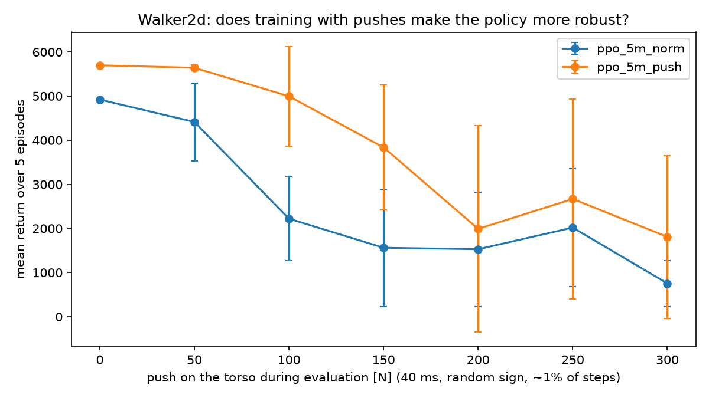

# Simulating a bipedal robot: balance, gait planning and learned walking

Getting humanoid robots to stand, survive pushes and walk in the MuJoCo physics simulator, using
three approaches: joint-level control, a physics-based gait planner (LIPM), and reinforcement
learning (PPO).



## Highlights

- **Found why a humanoid falls even when every joint tracks its target.** The Unitree H1 tips over
  backward within 2 s under joint PD control alone, because no motor acts on the floating torso.
- **Built an ankle-strategy balance controller that keeps the center of mass (CoM) over the feet.**
  It keeps H1 standing across a wide range of gains, and survives every push up to 150 N forward and
  200 N backward. The textbook torso-pitch version sometimes fails at 25 N.
- **Planned a walking pattern with the linear inverted pendulum model (LIPM),** following Kajita's
  analytic method: 8 steps, 1.40 m forward, with the CoM swaying only 3.2 cm between feet 20 cm apart.
- **Trained a walking policy with PPO in 8 minutes on a laptop CPU.** Observation normalization
  turned a walker that falls after ~370 steps into one that completes all 1,000.

## Results

| Step | What | Result |
|---|---|---|
| A1 | Unitree G1 held in its standing pose by joint servos | Stands at 0.792 m; survives a 75 N, 0.1 s push on the pelvis and falls at 100 N |
| A2 | Unitree H1 (torque motors), joint PD only | Falls backward within ~2 s; the base ends at 0.095 m |
| A2 | H1 + ankle feedback on torso pitch | Stands at 0.93 m, but only 9 of 64 gain pairs work, scattered across the grid |
| A2 | H1 + ankle feedback on CoM position | Stands at 0.95 m; 23 of 56 gain pairs work, in one connected region |
| A3 | LIPM walking plan, 8 steps | CoM travels 1.40 m; lateral sway 0.032 m with feet at ±0.10 m |
| A4 | PPO on Walker2d, 1M steps, raw observations | 1.7 min; falls after ~370 of 1,000 steps (return 1,123 ± 36) |
| A4 | PPO on Walker2d, 5M steps, normalized observations | 8.1 min (~10,200 steps/s); walks all 1,000 steps (return 4,920 ± 6) |
| A5 | H1 push recovery, CoM vs pitch feedback | CoM: no falls up to 150 N forward / 200 N backward. Pitch: falls already at 25 N |
| A5 | Walker2d trained with vs without random pushes, under 100 N pushes | 4 of 5 episodes completed vs 0 of 5 (one seed each) |

All numbers come from the scripts below, run on an Apple M5 MacBook (CPU only).

## What I learned

### Why H1 falls (A2)

A humanoid's torso is a *floating base*: no motor acts on it directly. Joint PD control keeps the
limbs in shape relative to each other, but nothing keeps the whole robot upright relative to the
world. Every H1 joint tracked its target to within a few hundredths of a radian, and the robot still
fell. In H1's standing pose its CoM is only about 1 cm in front of the heel, so it tips backward.

The fix is the *ankle strategy*: shift both ankle targets to push the body back over the feet. I
tried two versions:

- **Torso pitch feedback** (`k1·pitch + k2·pitch rate`), the textbook version. It works, but only for
  isolated gain pairs. The robot rocks back and forth, and a slightly different gain tips it over
  ([sweep](results/h1_sweep_pitch.csv)).
- **CoM feedback** (`k1·(CoM x − foot centre) + k2·CoM velocity`). It works across one wide,
  connected region of gains ([sweep](results/h1_sweep_com.csv)). This targets the real condition for
  balance: the CoM, and so the zero-moment point (ZMP), has to stay over the foot.

### A5: how hard a push can each controller take?



I pushed H1's pelvis for 0.1 s at a random time between 2 and 3 s, five times per setting, with
forces from 0 to 400 N in both directions. A trial counts as survived if the base is still above
0.5 m at 6 s. The CoM controller survived every trial up to 150 N forward and 200 N backward. The
pitch controller lost some trials at 25 N and never survived above 100 N. Keeping the CoM over the
support area gives a far more robust controller than keeping the torso upright.
[Data](results/h1_push_survival.csv).

### Gait planning with the inverted pendulum (A3)



The LIPM treats the robot as a point mass at a constant height, balanced on the stance foot. Within
a step the CoM follows a closed-form solution (cosh/sinh), and the ZMP stays on the stance foot.
Between steps, the next foot placement is corrected by least squares, so the CoM tracks Kajita's
"walk primitive". The plot shows the key idea of walking: the ZMP jumps from foot to foot while the
CoM glides smoothly between them.

Two mistakes taught me the most. Reading the walk primitive as the state at the start of a step,
instead of the end, flung the CoM far outside the feet. Starting from rest between the feet caused
a 0.4 m sideways lurch. Starting from the time-reverse of the first step's primitive fixed it.

### Learning to walk with PPO (A4)



Walker2d is a planar two-legged robot with 6 joints. The policy, a small neural network, reads 17
numbers (joint angles, velocities, torso height and tilt) and outputs 6 joint torques. It's rewarded
for moving forward and staying upright, and penalized for using a lot of torque. Without
observation normalization, PPO learns slowly: the inputs range from radians to tens of rad/s, and a
small network handles that badly. With normalization (`VecNormalize`), the same 1M steps
already reach the level of the raw run, and 5M steps give a stable walk. The deterministic test
scores higher than the training curve because it turns off the random exploration noise used in
training.

### A5 (RL): does training with pushes make the policy more robust?



I trained the same setup a second time with random pushes on the torso during training (up to
100 N, 40 ms, on about 1% of steps), then evaluated both policies under fixed-size pushes. At
100 N the normally trained policy never finished an episode (return 2,220 ± 955); the push-trained
one finished 4 of 5 (4,994 ± 1,131). Above 200 N both usually fell. **Caveat:** there is one training
seed per setting, and the push-trained policy also scored higher with no pushes (5,698 vs 4,920), so
part of the gap may be seed luck. Repeating with several seeds is the next step.
[Data](results/walker_push_robustness.csv).

## Run it

Requires [uv](https://docs.astral.sh/uv/). Python 3.13, MuJoCo 3.17.

```bash
uv sync

# Robot models: only the G1 and H1 folders of MuJoCo Menagerie
git clone --filter=blob:none --sparse https://github.com/google-deepmind/mujoco_menagerie third_party/mujoco_menagerie
git -C third_party/mujoco_menagerie sparse-checkout set unitree_g1 unitree_h1

# macOS only: the viewer runs under mjpython, which needs libpython next to the venv (redo after recreating .venv)
ln -sf "$(uv run python -c 'import sysconfig,os;print(os.path.join(sysconfig.get_config_var("LIBDIR"),sysconfig.get_config_var("LDLIBRARY")))')" .venv/
```

| Step | Command |
|---|---|
| 1. Explore the models | `uv run python sim/explore_models.py` |
| A1. Stand + push test | `uv run python sim/stand.py g1 --headless --push 75` |
| A1. In the viewer | `uv run mjpython sim/stand.py g1` (push: double-click a body, Ctrl + right-drag) |
| A2. Balance | `uv run python sim/balance_h1.py` |
| A2. Gain sweeps | `uv run python sim/balance_h1.py --sweep pitch` and `--sweep com` |
| A2. In the viewer | `uv run mjpython sim/balance_h1.py --view com` |
| A3. Gait plan | `uv run python sim/lipm_gait.py --show` |
| A4. Train | `uv run python rl/train_walker.py --steps 5000000 --name ppo_5m_norm` (~8 min) |
| A4. Train (no normalization) | `uv run python rl/train_walker.py --steps 1000000 --no-normalize --name ppo_1m_raw` |
| A4. Evaluate / watch | `uv run python rl/evaluate.py ppo_5m_norm` (add `--watch` to see it) |
| A4. Learning curves | `uv run python rl/plot_training.py` |
| A5. H1 push survival | `uv run python sim/push_experiment.py` |
| A5. RL push robustness | `uv run python rl/train_walker.py --push 100 --name ppo_5m_push`, then `uv run python rl/push_robustness.py ppo_5m_norm ppo_5m_push` |
| Demo GIF | `uv run python scripts/record_gif.py` |

## Layout

```
sim/        MuJoCo humanoids: model explorer, standing, balance, LIPM planner, push experiment
rl/         Walker2d PPO: training, evaluation, push wrapper, plots
scripts/    demo GIF recorder (renders offscreen)
results/    CSVs, plots and the GIF produced by the scripts
ros2_ws/    ROS 2 Jazzy workspace: my own biped's URDF, ros2_control, Gazebo launch, squat node
docker/     ROS 2 + Gazebo desktop in the browser
runs/       trained models and logs (not committed)
third_party/  MuJoCo Menagerie models (not committed)
```

## Next: my own biped in ROS 2 + Gazebo

`ros2_ws/` holds an 8-joint biped I designed: hip roll, hip pitch, knee and ankle pitch per leg;
14.6 kg; 0.94 m to the top of the torso. It's described in xacro with one leg macro used twice, and
its inertias are computed from the link shapes. It's controlled through ros2_control in Gazebo
Harmonic. The `squat` node bends each knee by 2d and the hip and ankle pitch by −d. Because the
thigh and shin are the same length, the hip stays straight above the ankle and the foot stays flat.

Status: I checked the URDF by loading it into MuJoCo, where the free-standing robot squats to
d = 0.4 rad for 20 s with under 2° of torso tilt. It hasn't been run in ROS 2 or Gazebo yet.

```bash
docker compose -f docker/compose.yaml up            # open http://localhost:6080; setup steps are in the file
ros2 launch biped_description display.launch.py     # RViz with a slider per joint
ros2 launch biped_description gazebo.launch.py      # Gazebo + controllers
ros2 run biped_control squat
```

Planned: port the A2 balance controller and the A3 planner into ROS 2 nodes, switch the joints to
effort control, and add an IMU sensor.

## References

- E. Todorov et al., MuJoCo; the Unitree G1 and H1 models from [MuJoCo Menagerie](https://github.com/google-deepmind/mujoco_menagerie)
- S. Kajita et al., *Introduction to Humanoid Robotics*, Springer, ch. 4 (LIPM, analytic walking pattern generation)
- J. Schulman et al., "Proximal Policy Optimization Algorithms", 2017
- [Stable-Baselines3](https://stable-baselines3.readthedocs.io/), [Gymnasium Walker2d](https://gymnasium.farama.org/environments/mujoco/walker2d/)
- [ROS 2 Jazzy](https://docs.ros.org/en/jazzy/), [gz_ros2_control](https://control.ros.org/jazzy/doc/gz_ros2_control/doc/index.html)
